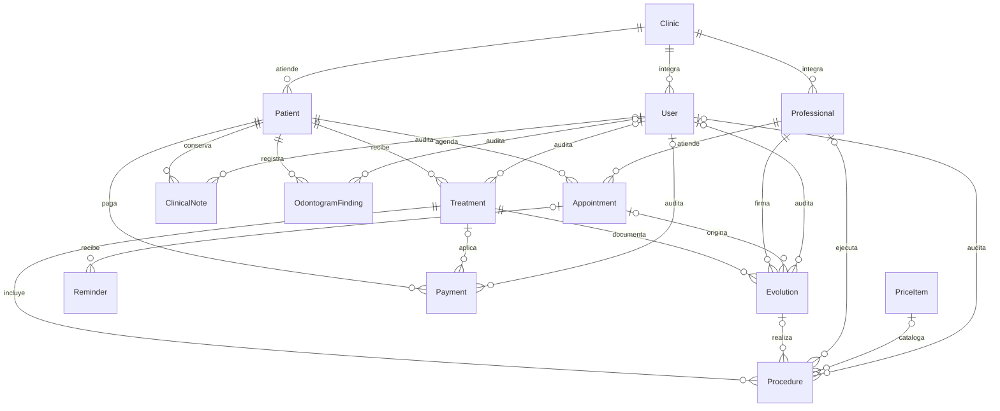

# Modelo de datos clínico

Clinika AI separa el seguimiento clínico del cobro. La unidad clínica principal es el tratamiento; sus evoluciones documentan sesiones y sus prestaciones expresan el plan y lo realizado. Los importes se almacenan en MXN con precisión decimal.

## Entidades

- `Clinic`, `User` y `Professional`: delimitan la organización, la identidad de sesión y la responsabilidad profesional.
- `Patient`: expediente maestro. Usa borrado lógico para que su historia nunca desaparezca por una eliminación accidental.
- `Appointment` y `Reminder`: agenda y comunicación. Un recordatorio puede señalar una cita exacta; si la cita desaparece, la referencia queda nula.
- `ClinicalNote`: nota SOAP independiente, firmada por profesional y con trazabilidad de usuario.
- `OdontogramFinding`: condición por pieza y superficie; la combinación paciente/pieza/superficie es única.
- `Treatment`: objetivo clínico macro, profesional responsable, estado y fechas.
- `Evolution`: sesión ordenada por fecha, avance acumulado, notas y próximos pasos.
- `Procedure`: prestación planificada o realizada, superficies, precio, cantidad, descuento y metadatos de realización.
- `Payment`: pago de paciente, opcionalmente aplicado a un tratamiento.
- `PriceItem`: tarifario reutilizable. `PatientFile` conserva metadatos de documentos.

## Reglas de Tratamiento → Evolución → Prestación

1. Una prestación `PLANIFICADA` pertenece al tratamiento y no tiene evolución.
2. Al realizarla pasa a `REALIZADA`, se enlaza a la evolución y copia su fecha y profesional en `performedAt`/`performedById`.
3. El avance de una evolución está entre 0 y 100 y no puede ser menor al de la sesión anterior. La interfaz sugiere el porcentaje por valor neto realizado, pero el profesional lo confirma.
4. Cantidad debe ser positiva. Precio y descuento no pueden ser negativos; el descuento de una línea no puede superar `precio × cantidad`.
5. Un tratamiento terminado debe llegar clínicamente a 100 %. El seed cumple esta regla; las acciones terminan automáticamente al registrar 100 %.
6. Saldo de tratamiento = prestaciones realizadas netas − pagos ligados al tratamiento. Las prestaciones planificadas no generan deuda.

## Dinero, catálogos y auditoría

Todo importe usa `Decimal(12,2)`. La aritmética de servidor vive en `src/lib/money.ts` con `Prisma.Decimal`; hacia componentes cliente se serializa como texto y se calcula en centavos enteros. No se suman importes con `number`.

Los conjuntos cerrados son enums Prisma. Las etiquetas visibles en español están centralizadas en `src/lib/utils.ts`; nunca se persisten etiquetas como si fueran valores del enum.

Todos los modelos de negocio tienen `createdAt` y `updatedAt`. Notas, tratamientos, evoluciones, prestaciones, hallazgos y pagos incluyen `createdById`/`updatedById` con `SET NULL`: una baja de usuario no borra la autoría histórica. Paciente, tratamiento, evolución y nota clínica usan `deletedAt`; las consultas normales agregan `deletedAt: null` mediante `src/lib/soft-delete.ts`.

## Eliminación e integridad

Las relaciones que sostienen historia clínica usan `RESTRICT`, en particular desde paciente, tratamiento y evolución. Las referencias opcionales y reemplazables —cita de recordatorio/evolución, catálogo, profesional ejecutor, pago aplicado y usuarios de auditoría— usan `SET NULL`. No se usa cascada para expedientes clínicos. Las restricciones `CHECK` de la base protegen avance, cantidad, importes y descuentos aunque una escritura no pase por la UI.

Cada llave foránea tiene índice. Además existen índices compuestos para agenda por clínica/profesional y fecha, tratamientos por estado, evoluciones por tratamiento/fecha, pagos por clínica/fecha y recordatorios pendientes.

## Migraciones seguras

1. Partir del último esquema desplegado y no reescribir migraciones ya aplicadas. La excepción actual es `20261101180000_procedure_parity`, consolidada antes de su primer despliegue.
2. Para un enum, normalizar primero valores desconocidos y después convertir con `USING`; agregar el default nuevamente al final.
3. Para columnas obligatorias, agregar con un valor seguro, rellenar datos existentes y luego instalar restricciones/FK/índices.
4. Convertir dinero con `ROUND(valor::numeric, 2)` y validar los datos antes de crear `CHECK`.
5. Ejecutar `prisma validate`, `prisma generate`, lint y build. En un entorno con PostgreSQL de prueba, aplicar desde cero y también desde una copia en la versión productiva antes de desplegar.
